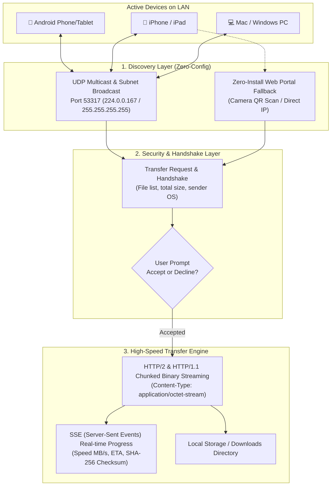

# OmniDrop Architecture Blueprint

## 1. High-Level System Architecture

OmniDrop is an open, cross-platform local peer-to-peer data transfer protocol and application engineered to provide an Apple AirDrop-like experience across **Android, iOS (iPhone/iPad), macOS, Windows, and Linux**.



---

## 2. Why Apple AirDrop Doesn't Work Across Non-Apple Devices

Apple AirDrop relies on two core layers:
1. **Bluetooth Low Energy (BLE)** for nearby beacon discovery.
2. **Apple Wireless Direct Link (AWDL)** for data transmission.

### The Apple Boundary:
- AWDL is a proprietary, closed-source Apple Wi-Fi driver extension.
- Third-party apps on iOS are **forbidden** from accessing AWDL or injecting raw 802.11 frames.
- Android devices have **Wi-Fi Direct (P2P)** and **Wi-Fi Aware (NAN)**, but iOS cannot communicate with Android Wi-Fi Direct without standard Wi-Fi Access Point association.

### How OmniDrop Solves This:
OmniDrop implements a **Universal 3-Tier Network Architecture**:

| Tier | Environment | Discovery Mechanism | Transport Protocol | Speeds |
| :--- | :--- | :--- | :--- | :--- |
| **Tier 1: Local Wi-Fi (Home / Office / Campus)** | Devices on the same Wi-Fi network | UDP Multicast / Broadcast (`53317`) | Direct HTTP Binary Streaming with Backpressure | 50 – 150 MB/s |
| **Tier 2: Zero-Install Web Receiver** | Any device with a browser (no app installed) | Camera QR Code scan (`http://ip:port`) | Web HTTP/SSE + Drag-and-drop | 40 – 100 MB/s |
| **Tier 3: Offline / Field Mode** | Outdoors, no Wi-Fi router available | Wi-Fi Hotspot on sender + QR scan | Direct Hotspot IP HTTP Transfer | 40 – 80 MB/s |

---

## 3. Protocol Flow

### Step 1: Device Discovery Beacon
Every device running OmniDrop broadcasts a periodic JSON beacon (every 3 seconds) over UDP port `53317`:
```json
{
  "protocol": "omnidrop-v1",
  "type": "BEACON",
  "id": "dev_9c82b1fa4e32",
  "name": "MacBook Pro (drfilms)",
  "deviceType": "desktop",
  "os": "mac",
  "ip": "192.168.1.33",
  "port": 53317,
  "timestamp": 1731000000000
}
```

### Step 2: Transfer Request & Handshake
Before sending any file bytes, the sender issues a request to the receiver's HTTP server:
`POST /api/transfer/request`
```json
{
  "transferId": "tf_a9f120",
  "sender": {
    "id": "dev_9c82b1fa4e32",
    "name": "MacBook Pro",
    "os": "mac"
  },
  "files": [
    { "index": 0, "name": "4K_Video.mp4", "size": 145028190, "type": "video/mp4" }
  ],
  "totalSize": 145028190
}
```

The receiver's UI plays an audible chime, triggers haptic vibration, and displays an AirDrop-style acceptance dialog:
- **Accept**: Receiver replies with `{ "accepted": true }`.
- **Decline**: Receiver replies with `{ "accepted": false }`, sender immediately cancels.

### Step 3: High-Speed Binary Streaming
Upon acceptance, the sender streams each file directly into the receiver's disk via `POST /api/transfer/upload/:transferId/:fileIndex`.
- Uses `application/octet-stream`.
- Stream is piped straight into a filesystem WriteStream using Node.js `stream.pipeline` (constant memory usage, never buffers entire files in RAM).
- Computes SHA-256 integrity hash on the fly.
- Throttled SSE events report real-time speed (MB/s), % complete, and ETA back to the UI.

---

## 4. Cross-Platform Compatibility Matrix

| From \ To | Android Mobile | iPhone | iPad / Tablets | Windows PC | Mac |
| :--- | :---: | :---: | :---: | :---: | :---: |
| **Android Mobile** | ✅ Full Speed | ✅ Full Speed | ✅ Full Speed | ✅ Full Speed | ✅ Full Speed |
| **iPhone** | ✅ Full Speed | ✅ Full Speed | ✅ Full Speed | ✅ Full Speed | ✅ Full Speed |
| **iPad / Tablets** | ✅ Full Speed | ✅ Full Speed | ✅ Full Speed | ✅ Full Speed | ✅ Full Speed |
| **Windows PC** | ✅ Full Speed | ✅ Full Speed | ✅ Full Speed | ✅ Full Speed | ✅ Full Speed |
| **Mac** | ✅ Full Speed | ✅ Full Speed | ✅ Full Speed | ✅ Full Speed | ✅ Full Speed |
